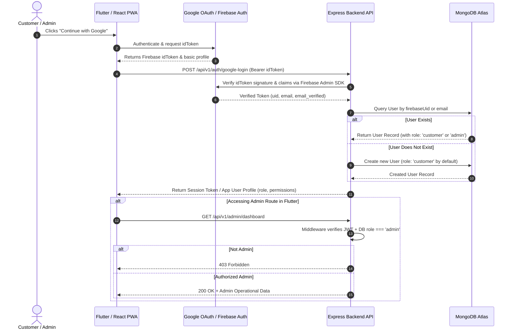
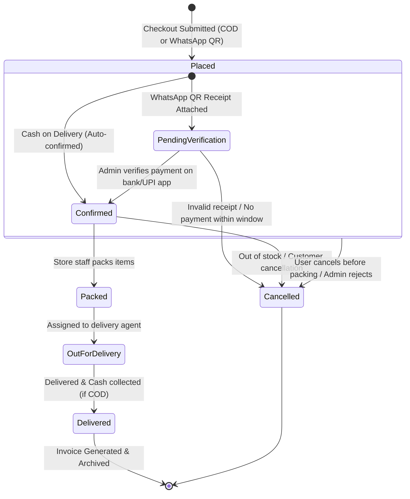

# System Architecture & Technical Specifications
## Kanhaiya General Store E-Commerce Platform

---

## 1. System Overview

The **Kanhaiya General Store E-Commerce Platform** is an enterprise-grade, cost-effective retail commerce solution designed specifically for local daily essentials, groceries, packaged foods, beverages, personal care, and general merchandise. 

The system serves three primary customer and operational touchpoints:
1. **Customer Android App**: Built with Flutter (Riverpod + GoRouter + Material 3) targeting Android smartphones with offline-tolerant browsing and smooth UX. Includes an integrated protected admin workspace accessible only to verified administrators.
2. **Customer Web / iPhone App (PWA)**: Built with React, TypeScript, and Vite as an installable Progressive Web Application (PWA) with mobile-first UI, Safari/iOS compatibility, manifest, and service worker caching.
3. **Store Management & Backend Services**: A Node.js + Express + TypeScript REST API powering business logic, pricing, inventory integrity, order state machines, PDF invoice generation, and security verification.

---

## 2. Component Responsibility Matrix

| Component | Technology | Primary Responsibilities | Deployment / Runtime Target |
| :--- | :--- | :--- | :--- |
| **Backend API** | Node.js, Express, TypeScript | REST endpoints, authentication token verification, role enforcement, dynamic pricing validation, atomic stock reservation, order state machine, PDFKit invoice generation. | Render (Free/Starter Web Service) |
| **Customer Android App** | Flutter 3.x, Dart, Riverpod, GoRouter, Dio | Storefront browsing, cart management, checkout initiation, order tracking, notifications feed, push notification listener, integrated Admin section. | Android APK / Google Play |
| **Customer PWA (iOS & Web)** | React 18/19, TypeScript, Vite, Vanilla CSS | Lightweight mobile storefront, installable home screen PWA, cart, checkout entry point, order status, responsive UI. | Netlify or Vercel |
| **Database** | MongoDB Atlas (M3/Free M0 tier initially) | Relational documents: Users, Roles, Categories, Products, Inventory, Orders, Invoices, Notifications, AppSettings. | Managed Cloud (AWS/GCP via Atlas) |
| **Authentication** | Firebase Auth + Google Sign-In | Client-side OAuth credential issuance, backend token verification via Firebase Admin SDK. | Google Cloud / Firebase |
| **Media Storage** | Cloudinary CDN | Asset optimization, responsive product thumbnails, category icons, banner hosting. | Cloudinary Free Tier |
| **Push Notifications** | Firebase Cloud Messaging (FCM) | Order dispatch updates, store broadcasts to Android apps. Web Push API fallback for PWA. | Google FCM / Web Push standard |
| **Invoicing Engine** | PDFKit (In-Engine Node.js) | Server-side cryptographic/hash-stamped invoice generation on delivery or order completion. | Embedded inside Backend service |

---

## 3. External vs. Local / In-House Services

| Service Domain | Provider / Mode | Rationale & Cost Strategy |
| :--- | :--- | :--- |
| **Database** | MongoDB Atlas (External) | Free M0 sandbox for development/staging; zero maintenance infrastructure. |
| **Authentication Authority** | Firebase Auth (External) | Zero server credential liability; free tier covers up to 50k MAUs. |
| **Role & Authorization** | Backend Node.js (Local/In-House) | **Zero trust:** Roles (`customer`, `store_admin`) are stored strictly in MongoDB and verified server-side. |
| **Image Hosting & CDN** | Cloudinary (External) | Free tier covers 25GB managed media; no self-hosted storage bloat. |
| **Payment Workflow** | In-House State Machine | **Zero Payment Gateway fees:** Cash on Delivery (COD) + Manual WhatsApp QR payment receipt verification. |
| **Push Notifications** | FCM & Web Push (External) | Completely free unlimited FCM notifications. |
| **Invoice Generation** | Node.js `pdfkit` (Local/In-House) | No third-party SaaS invoice API fees; generates deterministic PDF streams on demand. |

---

## 4. End-to-End Authentication & Authorization Flow

### Authorization Principles
- **No Client Elevation**: The client cannot request or specify role elevation.
- **Strict Role Derivation**: Administrator privileges are assigned manually by a database administrator or designated master seed.
- **Token Verification**: Every protected request must carry the `Authorization: Bearer <token>` header, parsed and validated by backend middleware.

---

## 5. Order & Payment State Machine

The general store operates without automated payment gateways (saving high transaction percentages and recurring gateway charges).

### Payment Verification Rules
- **Cash on Delivery (COD)**: Order moves to `Confirmed` immediately or after store operational confirmation.
- **WhatsApp QR**: Order requires manual upload of transaction reference / screenshot. Remains `PendingVerification` until store admin marks it verified.
- **Inventory Locking**: Inventory is reserved atomically when order enters `Placed`. If cancelled, inventory is released back.

---

## 6. Notification Delivery Architecture

1. **Transactional In-App Feed**: Stored in MongoDB `Notification` collection. Real-time updates delivered over REST or WebSocket/Polling.
2. **Android Push Notifications**: Backend invokes Firebase Cloud Messaging (FCM) server SDK to broadcast notifications to registered device tokens upon:
   - Order confirmation
   - Out for delivery
   - Order delivered
   - Promotional broadcast
3. **PWA Push Notifications**: Uses the standard Service Worker Push API + VAPID keys for modern desktop and Android browsers, with guidance for iOS Safari "Add to Home Screen" push requirements.

---

## 7. Environment & Configuration Strategy

Environment variables are partitioned cleanly across environments (`development`, `staging`, `production`) and enforced via runtime schema validation (Zod in backend).

| Variable Key | Scope | Sample / Purpose |
| :--- | :--- | :--- |
| `PORT` | Backend | `5000` |
| `NODE_ENV` | Backend | `development` / `production` |
| `MONGODB_URI` | Backend | `mongodb+srv://...` (Atlas connection string) |
| `JWT_SECRET` | Backend | Cryptographic secret for application tokens |
| `FIREBASE_PROJECT_ID` | Backend | Firebase application project identifier |
| `FIREBASE_CLIENT_EMAIL` | Backend | Service account client email |
| `FIREBASE_PRIVATE_KEY` | Backend | Service account private key (escaped newline format) |
| `CLOUDINARY_CLOUD_NAME` | Backend | Asset upload target cloud |
| `CLOUDINARY_API_KEY` | Backend | API key |
| `CLOUDINARY_API_SECRET` | Backend | Private API secret (backend only!) |
| `CORS_ORIGIN` | Backend | Comma-separated list of allowed origins |
| `VITE_API_BASE_URL` | React PWA | URL of the backend API (e.g., `http://localhost:5000/api/v1`) |
