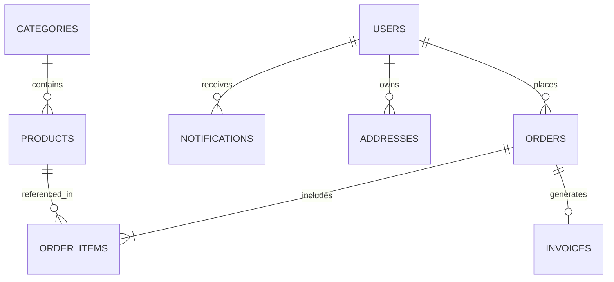

# Database Design & Schemas
## Kanhaiya General Store E-Commerce Platform

---

## 1. Storage Engine
- **Engine**: MongoDB Atlas (MongoDB 7.x+)
- **ORM / ODM**: Mongoose 8.x with TypeScript Schema typing
- **Indexing Strategy**: Single field indexes on lookups, compound indexes on multi-tenant / state queries, text index on product search.

---

## 2. Entity-Relationship & Collection Overview



---

## 3. Detailed Collection Schemas

### 3.1. `users` Collection
Stores both customers and administrative personnel.

```typescript
interface IUser {
  _id: ObjectId;
  firebaseUid: string;            // Unique from Firebase Auth (Indexed, Unique)
  email: string;                  // Lowercase, indexed
  displayName: string;
  phoneNumber?: string;
  role: 'customer' | 'admin' | 'store_manager'; // Default: 'customer'
  isActive: boolean;              // Default: true
  addresses: Array<{
    _id: ObjectId;
    recipientName: string;
    phone: string;
    streetAddress: string;
    landmark?: string;
    city: string;
    state: string;
    pincode: string;
    isDefault: boolean;
  }>;
  fcmTokens: string[];            // Push registration tokens
  createdAt: Date;
  updatedAt: Date;
}
```
**Indexes:**
- `{ firebaseUid: 1 }` (unique: true)
- `{ email: 1 }` (unique: true)
- `{ role: 1 }`

---

### 3.2. `categories` Collection
Top-level and sub-level product taxonomy (e.g., Staples, Snacks, Dairy, Cleaning).

```typescript
interface ICategory {
  _id: ObjectId;
  name: string;                   // e.g., "Atta, Rice & Dal"
  slug: string;                   // unique e.g., "atta-rice-dal"
  description?: string;
  imageUrl?: string;
  imagePublicId?: string;         // Cloudinary asset ID
  displayOrder: number;           // Priority sorting
  isActive: boolean;              // Soft activation
  createdAt: Date;
  updatedAt: Date;
}
```
**Indexes:**
- `{ slug: 1 }` (unique: true)
- `{ isActive: 1, displayOrder: 1 }`

---

### 3.3. `products` Collection
Catalog items for the general store.

```typescript
interface IProduct {
  _id: ObjectId;
  name: string;                   // e.g., "Aashirvaad Shudh Chakki Atta"
  slug: string;                   // unique e.g., "aashirvaad-shudh-chakki-atta-5kg"
  categoryId: ObjectId;           // Ref: categories
  description?: string;
  unit: string;                   // e.g., "5 kg", "1 L", "500 g", "1 Pack"
  mrp: number;                    // Maximum Retail Price in INR (e.g., 295.00)
  sellingPrice: number;           // Actual discounted price in INR (e.g., 265.00)
  stockQuantity: number;          // Available units (non-negative integer)
  isAvailable: boolean;           // Derived: stockQuantity > 0 && manual toggle
  images: Array<{
    url: string;
    publicId: string;
    isPrimary: boolean;
  }>;
  tags: string[];                 // ["flour", "atta", "wheat", "grocery"]
  createdAt: Date;
  updatedAt: Date;
}
```
**Indexes:**
- `{ slug: 1 }` (unique: true)
- `{ categoryId: 1, isAvailable: 1 }`
- `{ name: 'text', description: 'text', tags: 'text' }` (Full-text search)

---

### 3.4. `orders` Collection
Order lifecycle and immutable snapshot of products at purchase time.

```typescript
interface IOrderItem {
  productId: ObjectId;
  productName: string;
  unit: string;
  unitPrice: number;              // Verified price at order creation
  quantity: number;
  totalPrice: number;             // unitPrice * quantity
  imageUrl?: string;
}

interface IOrder {
  _id: ObjectId;
  orderNumber: string;            // Human-friendly: e.g., "KS-202610-0012"
  userId: ObjectId;               // Ref: users
  items: IOrderItem[];
  subtotal: number;               // Sum of item totals
  deliveryFee: number;            // Computed by store policy (e.g. Free > ₹500, else ₹30)
  discountTotal: number;
  totalAmount: number;            // subtotal + deliveryFee - discountTotal
  
  shippingAddress: {
    recipientName: string;
    phone: string;
    streetAddress: string;
    landmark?: string;
    city: string;
    state: string;
    pincode: string;
  };
  
  paymentMethod: 'cod' | 'whatsapp_qr';
  paymentStatus: 'pending' | 'verified' | 'failed' | 'collected';
  paymentReference?: string;      // UTR / Transaction id or WhatsApp proof note
  
  orderStatus: 'placed' | 'confirmed' | 'packed' | 'out_for_delivery' | 'delivered' | 'cancelled';
  cancellationReason?: string;
  cancelledBy?: 'customer' | 'admin' | 'system';
  
  timeline: Array<{
    status: string;
    timestamp: Date;
    note?: string;
  }>;

  createdAt: Date;
  updatedAt: Date;
}
```
**Indexes:**
- `{ orderNumber: 1 }` (unique: true)
- `{ userId: 1, createdAt: -1 }`
- `{ orderStatus: 1, createdAt: -1 }`

---

### 3.5. `invoices` Collection
Audit-proof fiscal invoice record generated upon delivery.

```typescript
interface IInvoice {
  _id: ObjectId;
  invoiceNumber: string;          // e.g. "INV-2026-10-0012"
  orderId: ObjectId;              // Ref: orders (Unique)
  userId: ObjectId;               // Ref: users
  pdfStoragePath?: string;        // Local or object storage reference
  generatedAt: Date;
  metadata: {
    storeName: string;
    storeAddress: string;
    storeGstOrPan?: string;
    storeContact: string;
  };
  totalAmount: number;
}
```
**Indexes:**
- `{ invoiceNumber: 1 }` (unique: true)
- `{ orderId: 1 }` (unique: true)
- `{ userId: 1 }`

---

### 3.6. `notifications` Collection
In-app notification records for customers and administrators.

```typescript
interface INotification {
  _id: ObjectId;
  recipientId: ObjectId;          // Ref: users
  title: string;
  body: string;
  type: 'order_update' | 'promotion' | 'system';
  dataPayload?: Record<string, any>;
  isRead: boolean;
  createdAt: Date;
}
```
**Indexes:**
- `{ recipientId: 1, isRead: 1, createdAt: -1 }`

---

### 3.7. `store_settings` Collection
Global operational configuration (single document pattern).

```typescript
interface IStoreSettings {
  _id: ObjectId;
  storeName: string;              // "Kanhaiya General Store"
  phone: string;
  whatsappNumber: string;
  upiId: string;                  // e.g. "kanhaiyastore@okaxis"
  qrImageUrl?: string;
  minOrderValue: number;          // e.g. 100 INR
  freeDeliveryThreshold: number;  // e.g. 500 INR
  standardDeliveryFee: number;    // e.g. 30 INR
  isStoreOpen: boolean;
  serviceablePincodes: string[];  // e.g. ["110001", "110002"]
  updatedAt: Date;
}
```
